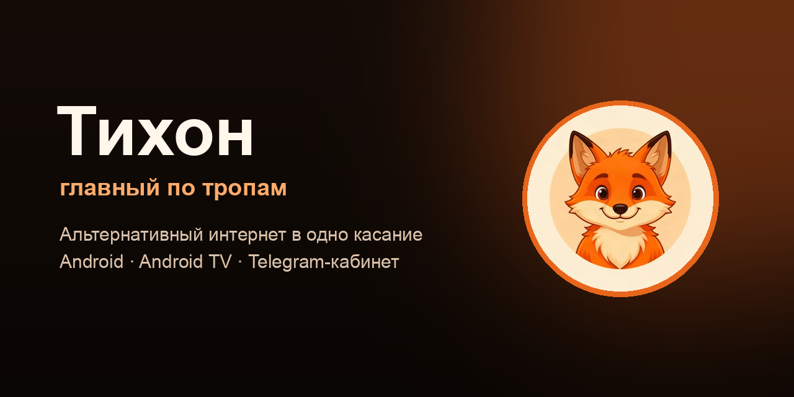
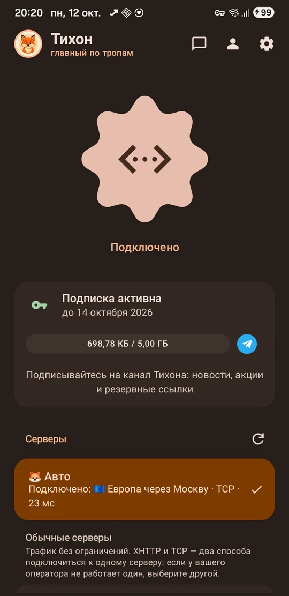
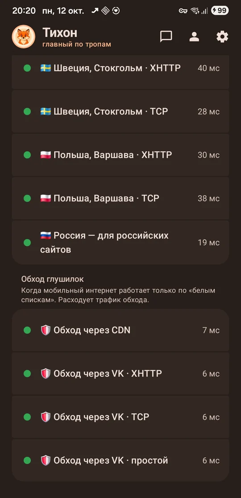
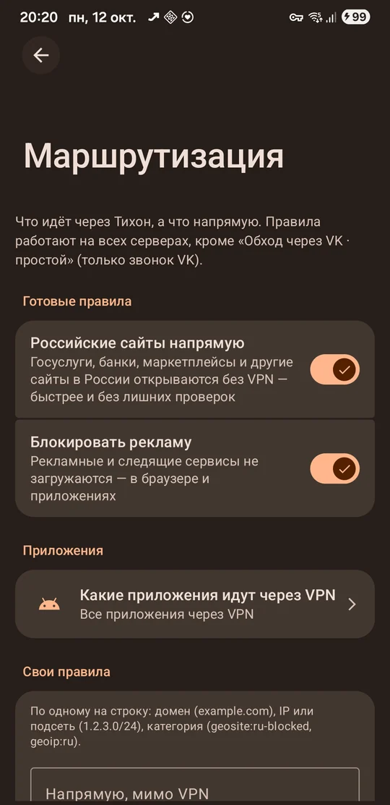
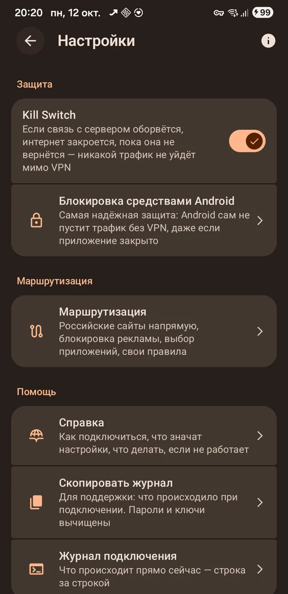
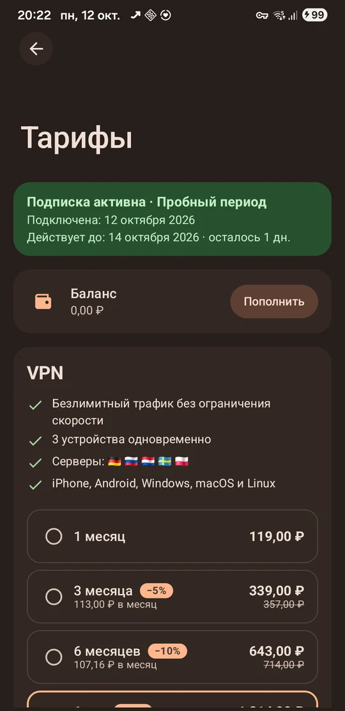
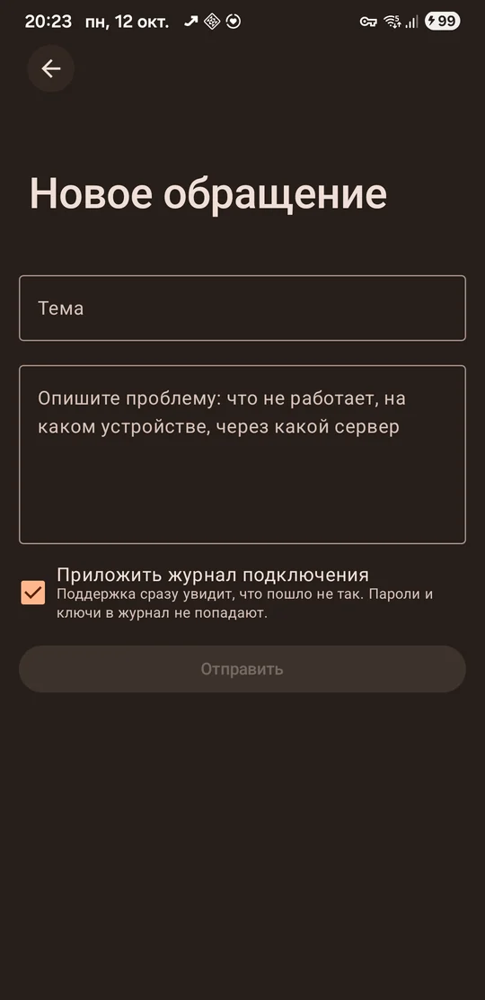

  
  
  

  <a href="https://tihon.website">Сайт</a> ·
  <a href="https://tihon.website/cabinet/">Личный кабинет</a> ·
  <a href="https://tihon.website/help/">Справка</a> ·
  <a href="CHANGELOG.md">Что нового</a> ·
  <a href="https://t.me/mtproxyvtg_bot">Telegram-бот</a>

---

**Тихон** — приложение для Android и Android TV, которое подключает телефон и телевизор к быстрым серверам в одно касание. Данные зашифрованы, связь держится, даже когда мобильный интернет капризничает. Нажали кнопку — и всё работает.

> 🦊 В большом лесу у каждого своя дорога. Широкие тракты заметны всем — на них и пробки, и заборы, и любопытные глаза. А лисёнок Тихон с детства знал: в лесу всегда найдётся тропа, по которой можно пройти быстро и тихо. Если тропа вдруг осыпалась — он не бросал путника на полпути, а находил новую. Приложение сделано по его характеру.

## Как выглядит

<table>
  <tr>
    <td align="center" width="33%"> <b>Одна кнопка</b> и понятное состояние</td>
    <td align="center" width="33%"> <b>Серверы</b> со статусом и пингом</td>
    <td align="center" width="33%"> <b>Маршрутизация</b> в пару переключателей</td>
  </tr>
  <tr>
    <td align="center"> <b>Защита и помощь</b> Kill Switch, справка, журнал</td>
    <td align="center"> <b>Тарифы и оплата</b> прямо в приложении</td>
    <td align="center"> <b>Поддержка</b> с журналом в одну галочку</td>
  </tr>
</table>

## Что умеет

| | |
|---|---|
| ⚡ **Одна кнопка и «Авто»** | Тихон сам проверяет серверы и подключает к самому быстрому из доступных — и показывает, к какому именно. Недоступные серверы не выбирает. Пока подключено, кнопка «живая», а таймер показывает время на связи. |
| 🟢 **Быстрые серверы** | У каждого сервера видно, отвечает ли он и с какой задержкой: зелёный — работает напрямую, жёлтый — через запасной путь, красный — нет связи. У многих серверов два способа подключения — XHTTP и TCP: если один не работает у вашего оператора, выберите другой. |
| 🛡 **Защита данных** | Весь трафик идёт по зашифрованному каналу — в кафе, в поездке и в чужом Wi-Fi никто не подсмотрит, что вы открываете. |
| 🔒 **Kill Switch** | Если связь с сервером оборвётся, интернет закроется, пока она не вернётся, — ничего не уйдёт мимо защиты. Плюс подсказка, как включить системную блокировку Android. |
| 🧭 **Маршрутизация** | Российские сайты — напрямую, реклама — блокируется, приложения — на ваш выбор (через Тихон или мимо), свои правила по доменам и адресам. Базы скачиваются сами. |
| 🌲 **Связь держится** | Если привычная дорога закрылась, Тихон сам находит другую тропу и остаётся на связи. |
| 📺 **Android TV** | То же приложение на телевизоре: вход по QR-коду с телефона («Аккаунт → Подключить телевизор»), управление пультом, подписка общая. |
| 💳 **Кабинет внутри** | Вход через Telegram или Яндекс ID, тарифы, баланс, оплата по СБП или картой, автопродление, трафик, устройства, история оплат. |
| 💬 **Поддержка рядом** | Обращения прямо из приложения; журнал подключения прикладывается одной галочкой (пароли и ключи из него вычищаются). О новом ответе подскажет точка на значке и уведомление. |
| 🔄 **Обновления сами** | Когда выходит новая версия, появится окно «Вышла новая версия» с кнопкой «Установить». |

## Установка

| Устройство | Что скачать |
|---|---|
| 📱 **Телефон или планшет** (Android 8.0+) | [ProTikhona-latest.apk](https://tihon.website/download/ProTikhona-latest.apk) — подходит большинству телефонов |
| 📺 **Android TV / Google TV** | [ProTikhona-tv.apk](https://tihon.website/download/ProTikhona-tv.apk) |
| 📟 **Старый 32-битный телефон** | [ProTikhona-latest-armeabi-v7a.apk](https://tihon.website/download/ProTikhona-latest-armeabi-v7a.apk) — если обычная версия пишет «Приложение не установлено» |

Сайт не открывается? Все файлы есть в разделе **[Releases](../../releases/latest)** здесь, на GitHub.

1. Скачайте файл и откройте его. Android спросит разрешение на установку из этого источника — разрешите.
2. Запустите «Тихон» и войдите через **Telegram** или **Яндекс ID** — без паролей. Новым аккаунтам доступен пробный период.
3. Нажмите большую кнопку — «Авто» само выберет быстрый сервер.

**На телевизоре:** установите файл через флешку или приложение-загрузчик, откройте Тихон — появится QR-код. На телефоне откройте Тихон → «Аккаунт» → «Подключить телевизор» и наведите камеру. Нет приложения на телефоне — отсканируйте QR обычной камерой и войдите через Telegram или Яндекс ID.

## Личный кабинет и Telegram

Подписку можно купить и без приложения — в **[личном кабинете](https://tihon.website/cabinet/)** на сайте или прямо в Telegram: кнопка **«Кабинет»** в [боте Тихона](https://t.me/mtproxyvtg_bot). Там тарифы, оплата (СБП, карта, звёзды Telegram), устройства, трафик, поддержка и приглашение друзей. Аккаунт, баланс и подписка общие для приложения, сайта и бота.

## Другие устройства

На **iPhone, iPad, Windows, macOS и Linux** подписка работает в приложениях Happ или Incy — подключить их можно в кабинете, раздел «Подключить». Обход ограничений мобильного интернета там может не работать: для полноценной работы используйте Android с приложением Тихона.

## Помощь

- **[Справка](https://tihon.website/help/)** — как подключиться, что значит каждая настройка, что делать, если не работает.
- **Поддержка** — в приложении (значок гарнитуры на главном экране), в кабинете или в [Telegram-боте](https://t.me/mtproxyvtg_bot).
- **Что нового** — [CHANGELOG.md](CHANGELOG.md) и [tihon.website/changelog.html](https://tihon.website/changelog.html).

## Лицензия

Тихон основан на открытом проекте WireTurn и использует компоненты с открытым исходным кодом (Xray, hev-socks5-tunnel и другие), распространяется под лицензией **GNU GPL v3**. Ссылки на исходные репозитории компонентов — в приложении: «Настройки» → значок «i». Исходный код приложения предоставляется по запросу через поддержку.

🦊 Тихон — главный по тропам

